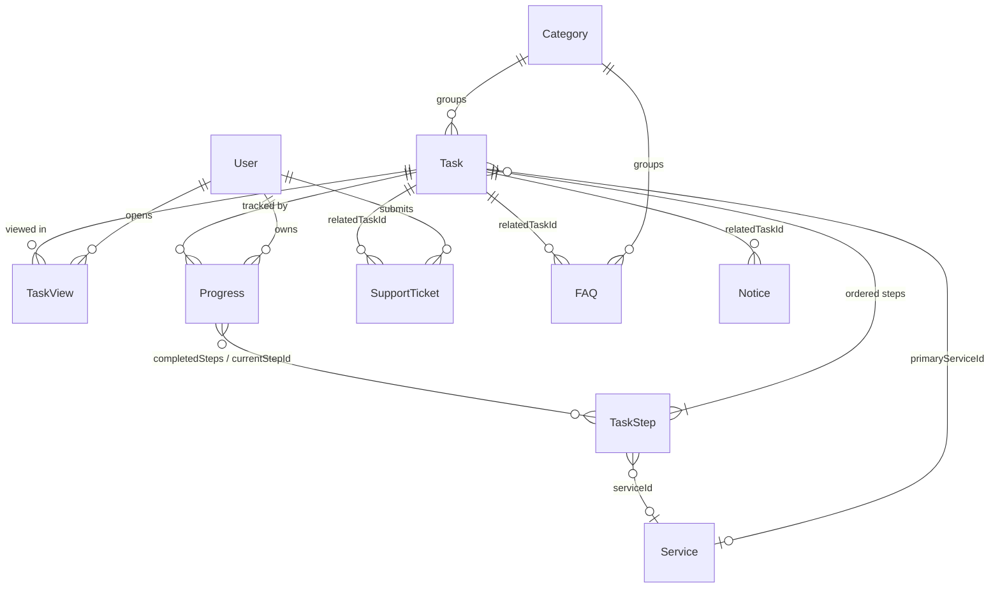

# Data Model (MongoDB + Mongoose)

Field names follow the master specification (`categoryId`, `taskId`, `serviceId`,
`studentId`, `relatedTaskId`) so both developers share one vocabulary. Where a
populated object is convenient, models expose a **virtual** with the friendly name
(`task.category`, `step.service`, `view.task`) while the stored field stays `*Id`.

Owner legend: **R** = Rohith (Module 1 / 2.1), **H** = Harshith (Module 2.2 / 3), **S** = shared.

## User (S)
| Field | Type | Notes |
| --- | --- | --- |
| name | String, 2–80 | required |
| email | String | required, unique, lower-cased |
| passwordHash | String | bcrypt, `select: false`, never serialised |
| registrationNumber | String | optional, unique when present (sparse index) |
| role | `student` \| `admin` | default `student`. Registration can never set `admin`; admins come from the seed script or a DB update |
| createdAt / updatedAt | Date | timestamps |

## Category (R)
| Field | Type | Notes |
| --- | --- | --- |
| name | String | required, unique |
| slug | String | unique, generated from name |
| code | String, 2–4 upper-case letters | unique, wayfinding code shown on cards (e.g. `ATT`) |
| description | String | ≤ 300 |
| icon | String | key from a whitelist in the frontend (`CategoryIcon`) |
| order | Number | display order |
| isActive | Boolean | default true |

## Task (R)
| Field | Type | Notes |
| --- | --- | --- |
| title | String ≤ 120 | required |
| slug | String | unique, generated once from the title (stable URLs) |
| summary | String ≤ 220 | short description for cards |
| description | String ≤ 4000 | full description |
| purpose | String ≤ 1000 | why a student does this |
| categoryId | ObjectId → Category | required, indexed |
| primaryServiceId | ObjectId → Service | optional; the main service for the task |
| requirements | [String] | documents / prerequisites before starting |
| importantNotes | [String] | important instructions |
| keywords | [String] | lower-cased; powers related-term search |
| estimatedDuration | Number (minutes) | optional — only when reasonably configured |
| verificationStatus | `unverified` \| `verified` | default `unverified`; shown as a badge |
| isFeatured | Boolean | admin "recommended" flag |
| isActive | Boolean | inactive tasks are hidden from students |
| viewerCount | Number | distinct students who opened the task (popularity) |
| virtuals | `category`, `primaryService`, `stepCount` | populated on read |

Indexes: `{ isActive, categoryId }`, `{ isActive, viewerCount: -1 }`, `slug` unique.

## TaskStep (R)
| Field | Type | Notes |
| --- | --- | --- |
| taskId | ObjectId → Task | required, indexed with `order` |
| order | Number ≥ 1 | maintained sequentially by the task service |
| title | String ≤ 140 | required |
| description | String ≤ 600 | short summary |
| instructions | [String] | ordered, detailed sub-steps |
| serviceId | ObjectId → Service | responsible service (optional) |
| isRequired | Boolean | default true; optional steps never block completion |
| prerequisites | [String] | |
| additionalNotes | String ≤ 1000 | important notes |
| checklist | [String] | "Done when…" self-check items |
| virtual | `service` | |

Step `_id`s are **preserved on edit** (the task service updates steps in place), so
saved progress that references step ids stays valid after an admin edits a task.

## Service (R)
| Field | Type | Notes |
| --- | --- | --- |
| name | String | required, unique (e.g. "UMS") |
| shortName | String | optional short label |
| description | String | what the service is for |
| serviceType | `portal` \| `mobile_app` \| `department` \| `help_desk` \| `other` | |
| officialUrl | String (http/https) | optional |
| verificationStatus | `unverified` \| `verified` | default `unverified` |
| accessNotes | String | how students usually reach it (generic, unverified unless marked) |
| isActive | Boolean | |
| virtual | `linkAvailable` | `true` only when verified **and** a URL exists. The UI never links otherwise |

## TaskView (R) — added for "recently accessed" and "popular"
| Field | Type | Notes |
| --- | --- | --- |
| studentId | ObjectId → User | from the JWT, never from the request body |
| taskId | ObjectId → Task | |
| viewCount | Number | visits: re-opening within 30 minutes (details → journey, refreshes) counts once |
| lastViewedAt | Date | refreshed on every open; drives "Recently opened" |

Unique index `{ studentId, taskId }`; `{ studentId, lastViewedAt: -1 }`. The first view
by a student increments `Task.viewerCount`. Deleting a task deletes its views.

## Progress (H) — shared contract, implemented by Module 2.2
| Field | Type | Notes |
| --- | --- | --- |
| studentId | ObjectId → User | always `request.user._id` |
| taskId | ObjectId → Task | unique together with `studentId` |
| completedSteps | [ObjectId → TaskStep] | must belong to `taskId` (validated server-side) |
| currentStepId | ObjectId → TaskStep \| null | next pending required step |
| status | `not_started` \| `in_progress` \| `completed` | `completed` when every **required** step is done |
| startedAt / lastAccessedAt / completedAt | Date | |

## FAQ, SupportTicket, Notice (H)
As listed in the master specification. Fields `categoryId` and `relatedTaskId`
reference the Module 1 collections above. When a task is deleted, Module 3 must treat a
missing `relatedTaskId` as "task no longer available" rather than erroring.
